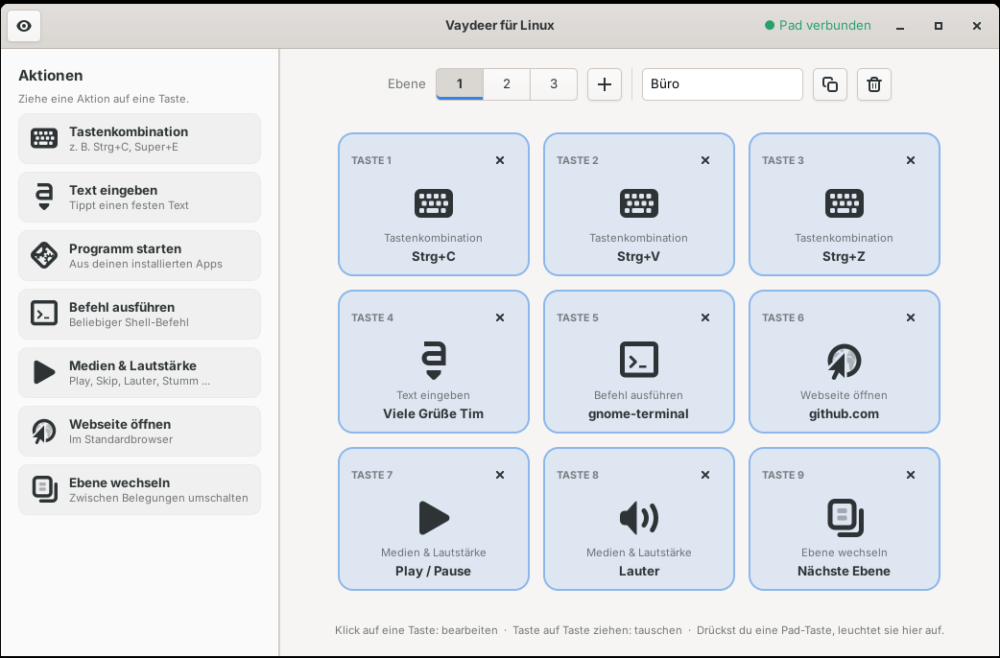
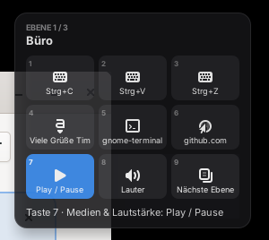
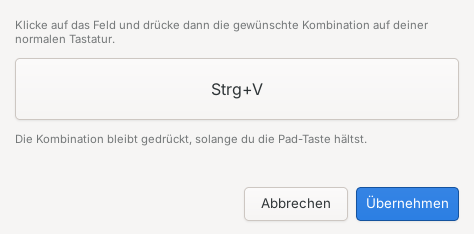

[English](README.md) · **Deutsch**

# Vaydeer für Linux

Ein inoffizieller Linux-Treiber mit Konfigurations-App für das **Vaydeer Macro Keypad mit
9 Tasten**. Belege die Tasten per Drag & Drop, wechsle zwischen Ebenen und sieh deine
Tastendrücke in einem kleinen Overlay, das immer im Vordergrund bleibt – wie bei der
offiziellen Windows-Software.



## Warum?

Das Pad sendet **keine** normalen Tastatur-Ereignisse. Seine Tasten werden nur über ein
herstellereigenes USB-HID-Protokoll gemeldet, das nur die offizielle Software (Windows/macOS)
versteht. Unter Linux passiert beim Drücken deshalb gar nichts, und Umbelegungs-Tools wie
input-remapper oder keyd sehen die Tasten nicht. Dieses Projekt liest das Protokoll direkt
aus und macht aus den Tastendrücken echte Aktionen.

## Funktionen

- **Belegung per Drag & Drop** – Aktion auf eine der 9 Tasten ziehen, fertig
- **Aktionen**
  - Tastenkombinationen (einfach durch Drücken aufnehmen, bleiben gedrückt, solange die
    Pad-Taste gehalten wird)
  - Text eingeben (deutsches QWERTZ-Layout inkl. Umlaute, `ß`, `@`, `€` …)
  - Installiertes Programm starten
  - Shell-Befehl ausführen
  - Medien & Lautstärke (Play/Pause, Weiter, Zurück, Lauter, Leiser, Stumm, Mikrofon aus)
  - Webseite öffnen
  - Ebene wechseln (nächste, vorherige oder eine bestimmte)
- **Bis zu 50 Ebenen** – hinzufügen, duplizieren, umbenennen und löschen
- **Live-Ansicht** – Tasten leuchten in der App auf, wenn du sie auf dem Pad drückst, und die
  gerade auf dem Pad aktive Ebene ist markiert
- **Overlay** – klein, transparent, immer im Vordergrund: zeigt die aktive Ebene, alle
  9 Tasten und die letzte Aktion. Immer sichtbar oder nur bei Tastendruck, normal oder kompakt
- **Unbelegte Tasten senden F13–F21** und sind so weiter in anderen Programmen nutzbar
- Änderungen gelten sofort, ohne Neustart
- Läuft als dein Benutzer (kein Root-Dienst) und startet automatisch nach der Anmeldung

| Overlay | Tastenkombination aufnehmen |
|---|---|
|  |  |

## Unterstützte Geräte

| Gerät | USB-ID | Status |
|---|---|---|
| Vaydeer 9-key Smart Keypad | `0483:5752` | ✅ getestet |
| Andere Vaydeer-Pads (z. B. 4 Tasten) | ? | ❓ ungetestet – Rückmeldungen willkommen |

Dein Gerät prüfst du mit `lsusb`. Wenn du ein anderes Vaydeer-Modell hast, eröffne gern ein
Issue mit der Ausgabe von `lsusb` und den Hex-Daten wie in [docs/PROTOCOL.md](docs/PROTOCOL.md)
beschrieben.

## Voraussetzungen

- Eine Debian-/Ubuntu-basierte Distribution (nutzt `apt`); getestet mit **Ubuntu 24.04 und GNOME**
- Python 3, GTK 4 (App) und GTK 3 (Overlay) – werden automatisch installiert
- systemd-Benutzersitzung

## Installation

```bash
git clone https://github.com/timkunathde-dev/vaydeer-linux.git
cd vaydeer-linux
./install.sh
```

Das Skript **ohne** `sudo` starten – es fragt selbst nach dem Passwort, wenn nötig.
Danach **„Vaydeer für Linux“** aus dem Startmenü öffnen oder `vaydeer-linux` ausführen.

Zeigt die App „Keine Berechtigung“, einmal ab- und wieder anmelden.

Zum Aktualisieren die neueste Version holen und `./install.sh` erneut ausführen.
Deine Belegung bleibt erhalten.

## Bedienung

- **Taste belegen:** Aktion von links auf eine Taste ziehen oder auf eine leere Taste klicken
- **Bearbeiten:** auf eine belegte Taste klicken
- **Tauschen:** eine Taste auf eine andere ziehen
- **Leeren:** auf das × einer Taste klicken
- **Ebenen:** über die Nummern oben wechseln; `+` fügt eine Ebene hinzu, die Knöpfe neben dem
  Namensfeld duplizieren oder löschen die aktuelle Ebene
- **Overlay:** über das Augen-Symbol oben links einschalten. Mit der Maus verschieben,
  Rechtsklick für Optionen (Sichtbarkeit, Größe, Deckkraft)

## Funktionsweise

| Komponente | Aufgabe |
|---|---|
| `vaydeerd.py` | Hintergrunddienst (systemd-Benutzerdienst). Liest die Roh-HID-Reports des Pads und führt die Aktionen über eine virtuelle Tastatur (uinput) aus. |
| `vaydeer-gui.py` | Konfigurations-App (GTK 4) |
| `vaydeer-overlay.py` | Overlay-Fenster (GTK 3) |
| `vaydeer_common.py` | Gemeinsamer Code: Protokoll, Konfiguration, Status |

Der Installer legt eine udev-Regel an, damit der angemeldete Benutzer auf das Pad (`hidraw`)
und `/dev/uinput` zugreifen darf, und installiert den Dienst als **Benutzerdienst**, damit
gestartete Programme in deiner Sitzung laufen.

**Warum GTK 3 für das Overlay?** Unter Wayland dürfen Programme sich weder selbst im
Vordergrund halten noch ihre Position bestimmen. Das Overlay läuft deshalb über XWayland,
wo beides funktioniert. Spiele oder Videos im Vollbild können es trotzdem verdecken.

### Dateien

| Pfad | Inhalt |
|---|---|
| `~/.config/vaydeer-linux/config.json` | Tastenbelegung und Ebenen |
| `~/.config/vaydeer-linux/overlay.json` | Overlay-Einstellungen und Position |
| `~/.config/autostart/vaydeer-overlay.desktop` | Autostart des Overlays (wenn aktiviert) |
| `/opt/vaydeer-linux/` | Programmdateien |

## Fehlersuche

```bash
systemctl --user status vaydeerd          # läuft der Dienst?
journalctl --user -u vaydeerd -f          # Protokoll des Dienstes
python3 /opt/vaydeer-linux/vaydeerd.py --debug   # manuell starten (vorher Dienst stoppen)
```

- **Tasten machen nichts:** prüfen, ob der Dienst läuft und `lsusb` die ID `0483:5752` zeigt.
  Manche Nutzer berichten, dass das Pad nur direkt am PC funktioniert, nicht an einem USB-Hub.
- **Getippter Text hat falsche Zeichen:** Die Texteingabe geht von einem deutschen
  Tastaturlayout aus.

## Deinstallation

```bash
./install.sh --uninstall
```

Deine Belegung in `~/.config/vaydeer-linux/` bleibt erhalten.

## Mitmachen

Issues und Pull Requests sind willkommen – besonders Rückmeldungen zu anderen
Vaydeer-Modellen, weiteren Tastaturlayouts und Übersetzungen der Oberfläche.

## Hinweis

Dies ist ein unabhängiges Community-Projekt. Es steht **in keiner Verbindung zu Vaydeer** und
wird von Vaydeer weder unterstützt noch empfohlen. „Vaydeer“ ist eine Marke des jeweiligen
Inhabers und wird hier nur zur Beschreibung der Kompatibilität verwendet. Das USB-Protokoll
wurde durch Beobachten der vom Gerät gesendeten Daten ermittelt; es wird kein Code der
offiziellen Software verwendet.

## Lizenz

[MIT](LICENSE)
