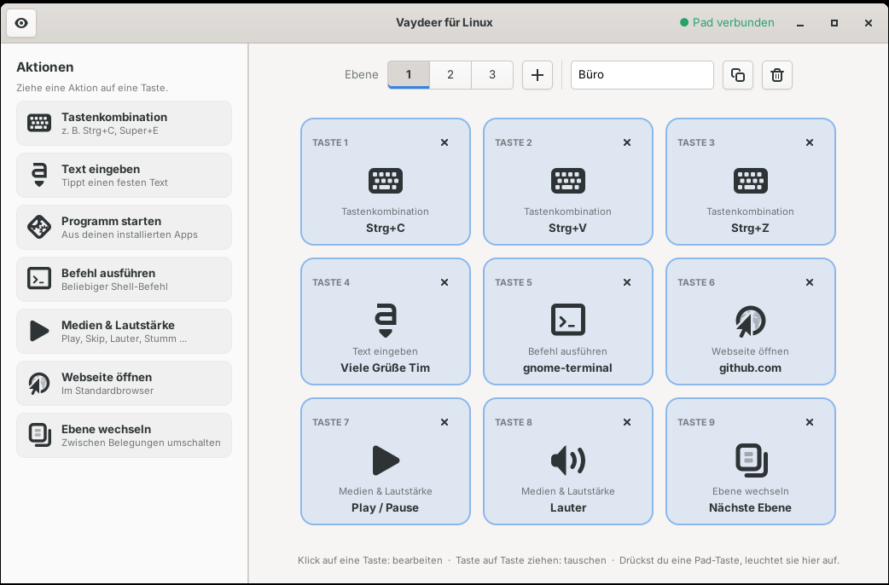
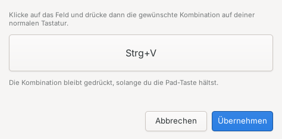

**English** · [Deutsch](README.de.md)

# Vaydeer for Linux

An unofficial Linux driver and configuration app for the **Vaydeer 9-key macro keypad**.
Assign actions to the keys by drag & drop, switch between layers and see your key presses
in a small always-on-top overlay – just like the official Windows software.



## Why?

The keypad does **not** send normal keyboard events. Its keys are only reported through a
vendor-specific USB HID protocol that the official (Windows/macOS-only) software understands.
On Linux the keys therefore do nothing at all, and generic remapping tools like
input-remapper or keyd cannot see them. This project reads that protocol directly and turns
key presses into real actions.

## Features

- **Drag & drop configuration** – drag an action onto one of the 9 keys, done
- **Actions**
  - Key combinations (recorded by simply pressing them, held as long as the pad key is held)
  - Type text (German QWERTZ layout, including umlauts, `ß`, `@`, `€` …)
  - Launch an installed application
  - Run a shell command
  - Media & volume (play/pause, next, previous, louder, quieter, mute, mic mute)
  - Open a website
  - Switch layer (next, previous or a specific layer)
- **Up to 50 layers** – add, duplicate, rename and delete them
- **Live view** – keys light up in the app when you press them on the pad, and the layer
  that is currently active on the pad is highlighted
- **Overlay** – small, transparent, always on top: shows the active layer, all 9 keys and
  the last action. Always visible or only on key press, normal or compact
- **Unassigned keys send F13–F21**, so they can still be used in other programs
- Changes apply instantly, no restart needed
- Runs as your user (no root daemon), starts automatically after login

| Overlay | Recording a key combination |
|---|---|
|  |  |

## Supported hardware

| Device | USB ID | Status |
|---|---|---|
| Vaydeer 9-key Smart Keypad | `0483:5752` | ✅ tested |
| Other Vaydeer keypads (e.g. 4 keys) | ? | ❓ untested – reports welcome |

Check your device with `lsusb`. If you own another Vaydeer model, please open an issue with
the output of `lsusb` and the hex output described in [docs/PROTOCOL.md](docs/PROTOCOL.md).

## Requirements

- A Debian/Ubuntu based distribution (uses `apt`); tested on **Ubuntu 24.04 with GNOME**
- Python 3, GTK 4 (app) and GTK 3 (overlay) – installed automatically
- systemd user session

> **Note:** The user interface is currently in German. Translations are welcome!

## Installation

```bash
git clone https://github.com/timkunathde-dev/vaydeer-linux.git
cd vaydeer-linux
./install.sh
```

Run the script **without** `sudo` – it asks for your password when needed.
Then start **“Vaydeer für Linux”** from your app menu or run `vaydeer-linux`.

If the app shows *“Keine Berechtigung”* (no permission), log out and back in once.

To update, pull the latest version and run `./install.sh` again. Your configuration is kept.

## Usage

- **Assign a key:** drag an action from the left onto a key, or click an empty key
- **Edit:** click an assigned key
- **Swap keys:** drag a key onto another key
- **Clear:** click the × on a key
- **Layers:** use the number buttons at the top; `+` adds a layer, the buttons next to the
  name field duplicate or delete the current layer
- **Overlay:** click the eye icon in the top-left corner. Move the overlay with the mouse,
  right-click it for options (visibility, size, opacity)

## Service and autostart

The background service starts automatically when you log in to your desktop. You can
control it with these commands (note: `--user` and **no** `sudo`):

```bash
systemctl --user start vaydeerd      # start
systemctl --user stop vaydeerd       # stop
systemctl --user restart vaydeerd    # restart
systemctl --user status vaydeerd     # check whether it is running
systemctl --user enable vaydeerd     # start automatically after login (default)
systemctl --user disable vaydeerd    # disable autostart
```

The service runs in your desktop session on purpose: launching apps, opening websites and
showing notifications all need it. If you want the keypad to work right after booting,
enable automatic login in your system settings.

The overlay can be started manually with `vaydeer-overlay`. When you turn it on in the app
(eye icon), it also starts automatically after login.

## How it works

| Component | Purpose |
|---|---|
| `vaydeerd.py` | Background service (systemd user unit). Reads the keypad's raw HID reports and performs the actions through a virtual keyboard (uinput). |
| `vaydeer-gui.py` | GTK 4 configuration app |
| `vaydeer-overlay.py` | GTK 3 overlay window |
| `vaydeer_common.py` | Shared code: protocol parser, configuration, state |

The installer adds a udev rule so the logged-in user may access the keypad (`hidraw`) and
`/dev/uinput`, and installs the service as a **user** service, so launched programs run in
your session.

**Why GTK 3 for the overlay?** Wayland does not let applications keep themselves on top or
choose their own position. The overlay therefore runs through XWayland, where both work.
Fullscreen games or videos may still cover it.

### Files

| Path | Content |
|---|---|
| `~/.config/vaydeer-linux/config.json` | Key mapping and layers |
| `~/.config/vaydeer-linux/overlay.json` | Overlay settings and position |
| `~/.config/autostart/vaydeer-overlay.desktop` | Overlay autostart (when enabled) |
| `/opt/vaydeer-linux/` | Program files |

## Troubleshooting

```bash
systemctl --user status vaydeerd          # is the service running?
journalctl --user -u vaydeerd -f          # service log
python3 /opt/vaydeer-linux/vaydeerd.py --debug   # run manually (stop the service first)
```

- **Keys do nothing:** check that the service is running and that `lsusb` lists `0483:5752`.
  Some users report that the keypad only works when plugged in directly, not through a USB hub.
- **Typed text has wrong characters:** text output assumes a German keyboard layout.

## Uninstall

```bash
./install.sh --uninstall
```

Your configuration in `~/.config/vaydeer-linux/` is kept.

## Contributing

Issues and pull requests are welcome – especially reports for other Vaydeer models,
other keyboard layouts and translations of the interface.

## Disclaimer

This is an independent community project. It is **not affiliated with, endorsed by or
supported by Vaydeer**. “Vaydeer” is a trademark of its respective owner and is used here
only to describe compatibility. The USB protocol was determined by observing the data sent
by the device; no code from the official software is used.

## License

[MIT](LICENSE)
